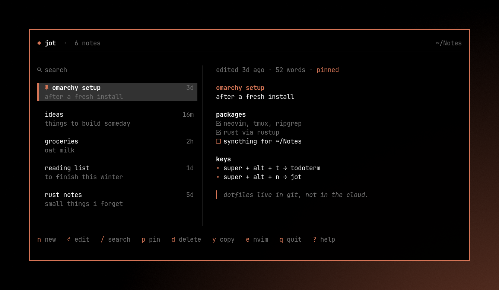

# ◆ jot

quick notes for the terminal. a list on the left, the rendered note on the right, an editor one key away.
made for [omarchy](https://omarchy.org): it floats, follows the current theme live, and opens on a hotkey.

notes are plain markdown files in `~/Notes`, one file per note, named after the first line.
edit them with anything, sync them with anything.



## install

### omarchy

```sh
git clone https://github.com/gloomyweather/jot
cd jot
contrib/omarchy/install.sh          # asks before touching the hyprland config
contrib/omarchy/install.sh --yes    # doesn't ask
contrib/omarchy/uninstall.sh        # removes everything, keeps your notes
```

this installs `~/.local/bin/jot` and:

* **super + alt + n**: open notes in a floating window, or focus it if it's already open
* **super + ctrl + alt + n**: quick note. a small window opens straight into a new note; `esc` saves and closes it
* "Notes" and "Quick Note" in the app launcher
* an icon that recolors itself on `omarchy theme set`

the installer builds jot with cargo, so you need rust (get it from rustup.rs).

### anywhere else

```sh
cargo install --git https://github.com/gloomyweather/jot
```

or grab `jot-<version>-x86_64-unknown-linux-gnu.tar.gz` from the [releases](https://github.com/gloomyweather/jot/releases) and put `jot` somewhere in your `PATH`. it runs in any terminal and uses the terminal's colors when there is no omarchy theme.

## use

```sh
jot                     # browse and edit
jot new [text]          # write a new note, quit when done
jot add "buy milk"      # save a note without opening anything
echo "idea" | jot add   # ...or from stdin
jot dir                 # print the notes folder
```

| list | | editor | |
|---|---|---|---|
| `n` | new note | `esc` | save and close |
| `⏎` `i` | edit | `ctrl+t` | toggle `- [ ]` checkbox |
| `e` | open in `$EDITOR` | `tab` `⇧tab` | indent / outdent |
| `/` | search (`⏎` with no match creates the note) | `ctrl+z` `ctrl+y` | undo / redo |
| `p` | pin to the top | `ctrl+← →` | move by word |
| `d` | delete (to `.trash/`) | `ctrl+w` | delete word |
| `u` | undo delete | `ctrl+s` | save now |
| `y` | copy to the clipboard | | |
| `J` `K` | scroll the preview | | |
| `?` | all keys | `f1` | all keys |

lists continue on enter (`- `, `- [ ] `, `1. `, `> `); enter on an empty item ends the list.
the note autosaves while you type, so closing the window never loses text.

## config

`~/.config/jot/config.toml`, every key optional:

```toml
dir = "~/Notes"       # or set JOT_DIR, or pass --dir
editor = "nvim"       # for `e`; default $VISUAL, $EDITOR, nvim
theme = "auto"        # "terminal" ignores the omarchy theme
```

## license

[gpl-3.0](LICENSE)
